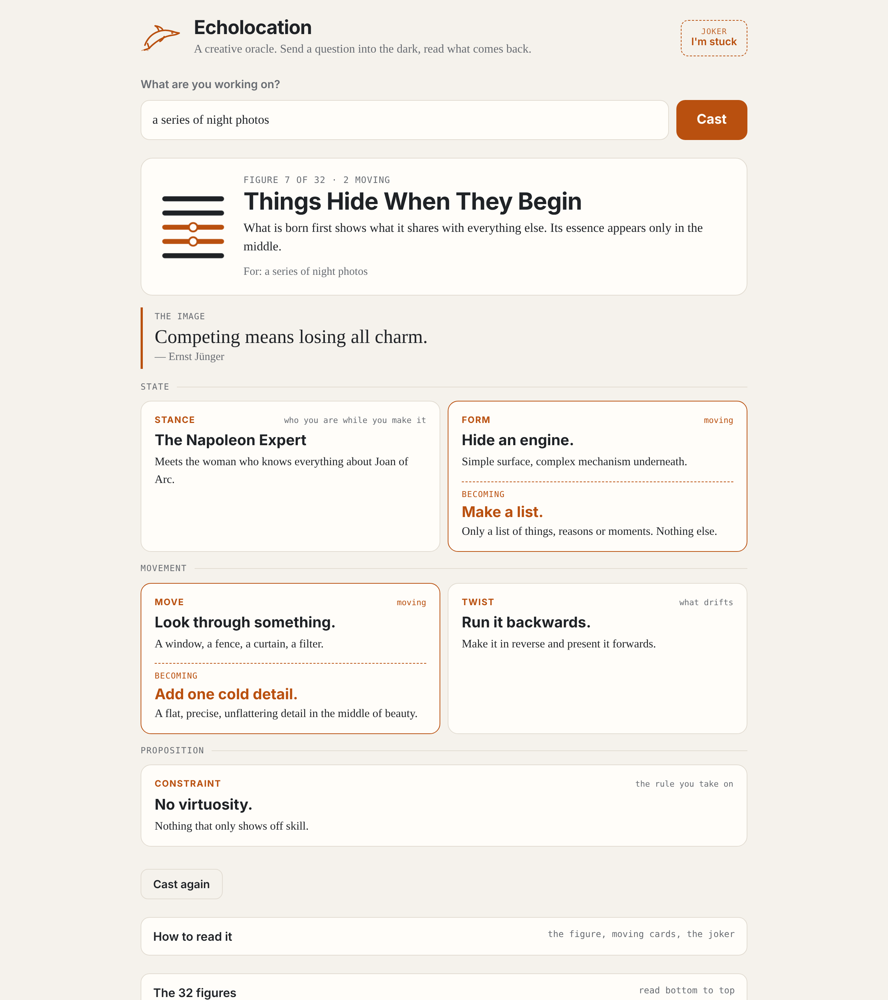

# Echolocation — a creative oracle

**Five cards for when you are stuck on a piece of work, any work: a poem, a photograph, a song, a book, a building. You ask a question, you cast, and you read the cards from the bottom up, like a figure of lines.**

**[▶ Open in your browser](https://quick-eyed-sky.github.io/echolocation/)** · [French guide](LISEZ-MOI.md)



*Free and open source. One page, no account, nothing sent anywhere.*

## How it works

Write the question you are carrying, or leave it blank, and press **Cast**. Five cards are drawn, one from each deck, and read from the bottom up in three tiers:

| Tier | Cards | What it tells you |
| --- | --- | --- |
| **State** | **Stance** and **Form** | Where you are: the posture to take, and the shape the work wants |
| **Movement** | **Move** and **Twist** | What happens next: an action to make, and a small oddity that drifts in |
| **Proposition** | **Constraint** | The rule you take on |

A **Strategy** sentence sits above the reading as its image.

About one card in four falls **moving**: it turns into another card from the same deck. Read what is *now*, then what it is *becoming*. The five cards, still or moving, make a figure of five lines, so there are **32 figures**, each with its name and its judgment.

## The joker

Sometimes you cannot even ask a question. Press **I'm stuck**, say where: *anywhere*, *at the start*, *in the middle*, *near the end*, or *it all feels flat*. The joker gives you one card, one thing to do now.

## Nothing here is generated

Every card, figure and sentence was written by hand, in one notebook kept between 2004 and 2011, then translated into English. No model writes the cards, and none is called when you cast. That is the point: the cards come from a person who was stuck too.

- **Stance**: 52 cards
- **Form**: 25
- **Move**: 51
- **Twist**: 36
- **Constraint**: 31
- **Strategy**: 40 sentences
- **Figures**: 32

## How it is made

Plain HTML, CSS and JavaScript, with no build step and no packages. The cards are in [`dist/decks.js`](dist/decks.js), the figures in [`dist/figures.js`](dist/figures.js), and the page in [`dist/index.html`](dist/index.html). Open `dist/index.html` directly in a browser, or serve the folder.

There are no analytics, remote fonts or external services. Your last question is remembered in your own browser only.

With Node.js 20+:

```sh
npm run check   # checks the decks and the 32 figures
```

## Who made this

Jean-Pascal — **[Quick-Eyed Sky](https://www.youtube.com/@QuickEyedSky)** on YouTube, **[QES](https://huggingface.co/QES)** on Hugging Face. Not a programmer: Echolocation is a way to send a signal into a stuck piece of work and listen to what comes back.

### Contributors

Coding assistance: **[Claude](https://github.com/claude) (Anthropic)**. Jean-Pascal directs the project and wrote every card.

If it gets you unstuck, you can [buy me a coffee](https://buymeacoffee.com/oFJ5CiY7n). Entirely optional, and Echolocation stays exactly as free either way.

## License

MIT — see [LICENSE](LICENSE).
